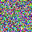

## Math {#math}

$$E = mc^2$$

::: {.notes}
these are the speaker notes
:::

## App {#app}

<iframe data-app="apps/big.html" width="600" height="300"></iframe>

## {#bgapp background-iframe="apps/app.html" background-interactive="true"}

## Pictures {#pics}

<object data="figures/shape.svg" type="image/svg+xml" width="200" height="100"></object>
<svg width="40" height="40"><image href="figures/dot.png" width="40" height="40"/></svg>

## Again {#again}

## Too wide {#wide}

::: {.absolute left=900 top=100 width=400}
past the right edge
:::
