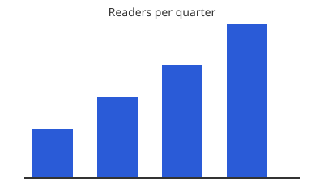

## What this deck is {#intro}

A made-up talk that uses every kind of slide and element qd edits.
Open it with `qd serve` and try each slide.

::: notes
Start here. Every slide after this shows one feature.
:::

## Formatting {#formatting}

Text can be **bold**, *italic*, [underlined]{.underline}, ~~struck~~,
[highlighted]{.mark}, `inline code`, or a [link](https://quarto.org).

Colour and size: [warm red]{style="color:#c0392b"},
[calm blue]{style="color:#2a5bd7"}, [a bigger word]{style="font-size:1.5em"},
and [a different font]{style="font-family:'Georgia'"}.

Inline math: $E = mc^2$.

## Lists and builds {#builds}

- Always shown
- Appears on click

::: {.fragment .fade-up fragment-index=2}
- Fades up on the next click
:::

::: {.fragment .highlight-red fragment-index=3}
- Turns red last
:::

::: {.fragment .fade-in-then-out fragment-index=1}
Comes in first, and goes on the next click
:::

1. Numbered
2. Lists
   - with a nested item

# Results {#results}

The results, in three slides you go down through.

## The numbers {#numbers}

| Quarter | Readers | Change |
|---------|--------:|-------:|
| Q1      | 1,200   | —      |
| Q2      | 1,850   | +54%   |
| Q3      | 2,600   | +41%   |

## The chart {#chart}

{width=70%}

# Two columns {#columns}

:::: {.columns}
::: {.column width="50%"}
**Before**

- Slow builds
- Manual edits
:::
::: {.column width="50%"}
**After**

- Instant drawings
- Edits on the slide
:::
::::

# Builds inside columns {#column-builds}

:::: {.columns}
::: {.column width="45%"}
::: {.fragment fragment-index=2}
- The list comes in second
- though it is written first
:::
:::
::: {.column width="55%"}
::: {.fragment .fade-up fragment-index=1}

:::
:::
::::

# Placed boxes {#boxes background-color="#f4f1ea" transition="zoom" transition-speed=slow}

::: {#box-note .absolute left=60 top=150 width=380}
A box placed by hand, with its own position.
:::

::: {#box-quote .absolute left=520 top=320 width=420 style="color:#2a5bd7"}
> Another one, a quote, further down.
:::

# The pipeline {#pipeline}

```{dot}
digraph {
  layout=neato; splines=ortho;
  data [label=Data, pos="0,0!", shape=box, style="rounded,filled", fillcolor=white, color="#c8ccd2", fontcolor="#1f2933"];
  tool [label=Tool, pos="1.5,0!", shape=box, style="rounded,filled", fillcolor="#3d4a5c", color="#3d4a5c", fontcolor=white];
  data -> tool;
  n1 [label=Review, shape=box, style="rounded,filled", fillcolor="#2a5bd7", color="#3d4a5c", fontcolor=white, pos="3,0!"];
  tool -> n1;
  n2 [label=Readers, shape=box, style="rounded,filled", fillcolor=white, color="#c8ccd2", fontcolor="#1f2933", pos="3,-1.25!"];
  n1 -> n2;
}
```

# Pointing at things {#arrows}

The arrows on this slide are drawn by qd.





# Math {#math}

$$
\int_0^1 x^2 \, dx = \frac{1}{3}
$$

The display equation above is edited as source.

# Code {#code}

```{python}
#| eval: false
readers = [1200, 1850, 2600]
print(sum(readers))
```

A plain code block:

```bash
qd serve --deck showcase.qmd
```

# A callout {#callout}

::: {.callout-tip title="Tip"}
Callouts, like other blocks qd can't type into, open as source.
:::

# A dark slide {#dark background-color="#1d2433"}

[White text on a dark background.]{style="color:#ffffff"}

# Moving between slides {#morph-a auto-animate=true}

::: {data-id="mover" style="color:#2a5bd7"}
A box that moves
:::

# Moving between slides {#morph-b auto-animate=true}

::: {data-id="mover" style="color:#c0392b; font-size:1.6em"}
A box that moves
:::

# Not shown when presenting {#hidden visibility="hidden"}

This slide is hidden: it shows here, marked, but not in the presentation.

# Thanks {#thanks}

Questions?
