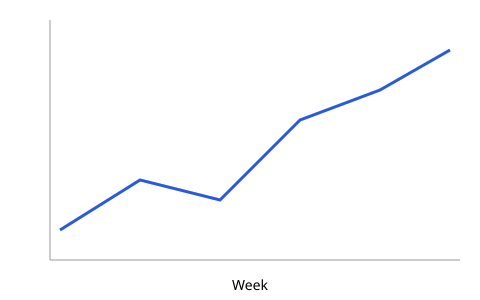

## Highlights {#highlights}

- Revenue grew in every region
- Two new products shipped
- Customer churn fell for the third quarter

::: notes
Start with the good news, then the chart.
:::

## Growth {#growth}

{width=70%}

## Two views {#columns}

:::: {.columns}
::: {.column width="50%"}
**Before**

- Manual reports
- Weekly updates
:::
::: {.column width="50%"}
**After**

- Live dashboards
- Daily updates
:::
::::

## The model {#model}

The forecast uses a simple growth law:

$$
N(t) = N_0 \, e^{r t}
$$

::: {.callout-note}
Rates are fitted per region.
:::

## Annotated {#annotated}

The headline number sits in a box you can move.

::: {.absolute top=380 left=620 width=300 height=120}
**+18%** year on year
:::

## Code {#code}

```{python}
#| eval: false
import matplotlib.pyplot as plt
plt.plot([1, 3, 2])
```

## Next steps {#next}
